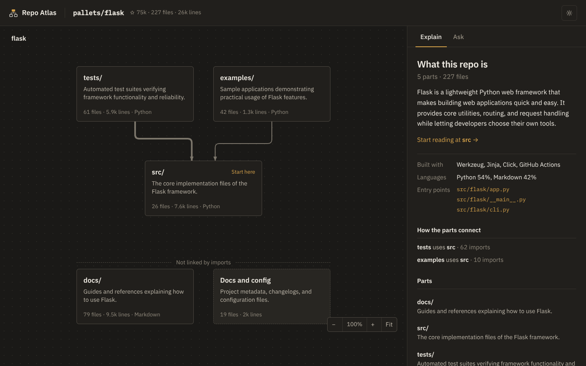
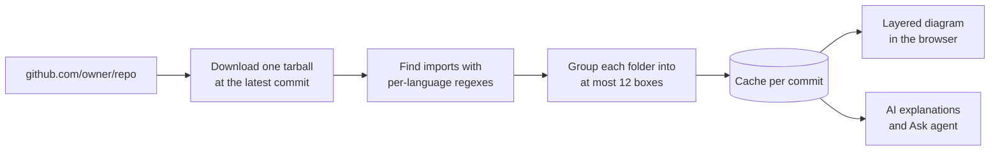

<div align="center">

# Repo Atlas

**Paste a public GitHub repo. Get a clear diagram of its main parts, how they depend on each other, and what each one does.**

[**Try it live**](https://repo-atlas-app.vercel.app) · [How it works](#how-it-works) · [Run it locally](#run-it-locally)




</div>

## What you get

| | |
| --- | --- |
| **The big picture** | Each folder becomes a box and arrows show which parts import which. Weak and reverse links are hidden so the main flow reads top to bottom. |
| **Plain English** | AI explains what the repo does at each level, gives every box a one-line role, and tells you where to start reading. |
| **One level deeper** | Click into any folder to see its own parts, down to single files with what they use and what uses them. |
| **Proof** | Click an arrow to see the real import lines behind it. Click a box to outline everything that depends on it. |
| **History** | Play the repo's growth over time, one band per part, sampled from its commits. |
| **Facts, not guesses** | What it's built with, the language split and the entry points are read from manifests, not from the AI. |
| **Ask** | An agent searches and reads the code to answer your question, and highlights the parts it talks about. |

Dark mode is the default; the toggle in the top right switches to light.

## How it works



**Backend (FastAPI).** Downloads the repo once, reads it in memory and finds imports for Python, JS/TS (including tsconfig path aliases), Go, Rust, Java/Kotlin, C/C++, Ruby and CSS. Only imports that resolve to a file in the repo count. Each folder is grouped into at most 12 boxes, wrapper folders like a lone `src/` are skipped, and imports between boxes are added up. Everything is cached per commit.

**Frontend (Next.js).** Lays each level out in layers: cycles are broken, parts that use others sit above what they use, rows are ordered to cut crossings, and arrows that skip a row bend around the cards in the way.

**AI.** Free-tier models through an OpenAI-compatible API, Groq first with Gemini as a backup. The Ask agent has three tools over the downloaded code (`search_code`, `read_file`, `list_dir`) and streams each step to the browser.

## Project layout

```
backend/app/
  github.py     repo info and the code as one tarball
  imports.py    which files import which, per language
  analyze.py    turn the files into the snapshot the map draws
  levels.py     group one folder into a handful of boxes
  timeline.py   how the repo grew, measured across its commits
  stack.py      built-with, languages and entry points from manifests
  ai.py         summaries, explanations and the Ask agent
  store.py      caching by commit and rate limits
  main.py       FastAPI routes
frontend/components/
  Diagram.tsx   the layered diagram
  Atlas.tsx     the page: diagram, side panel and Ask
  TimelineBar.tsx, HistoryTree.tsx   history playback
```

## Run it locally

```bash
# Backend
cd backend
python -m venv .venv && .venv/bin/pip install -r requirements-dev.txt
export GITHUB_TOKEN=... GROQ_API_KEY=...   # see .env.example, or ENABLE_MOCK_MODEL=1
.venv/bin/uvicorn app.main:app --reload --port 8000
.venv/bin/pytest

# Frontend
cd ../frontend
npm install
npm run dev   # http://localhost:3000, talks to NEXT_PUBLIC_API_URL (default http://localhost:8000)
```

---

<div align="center">

Built by [Ziyad Hisham](https://ziyadhisham.com)

</div>
